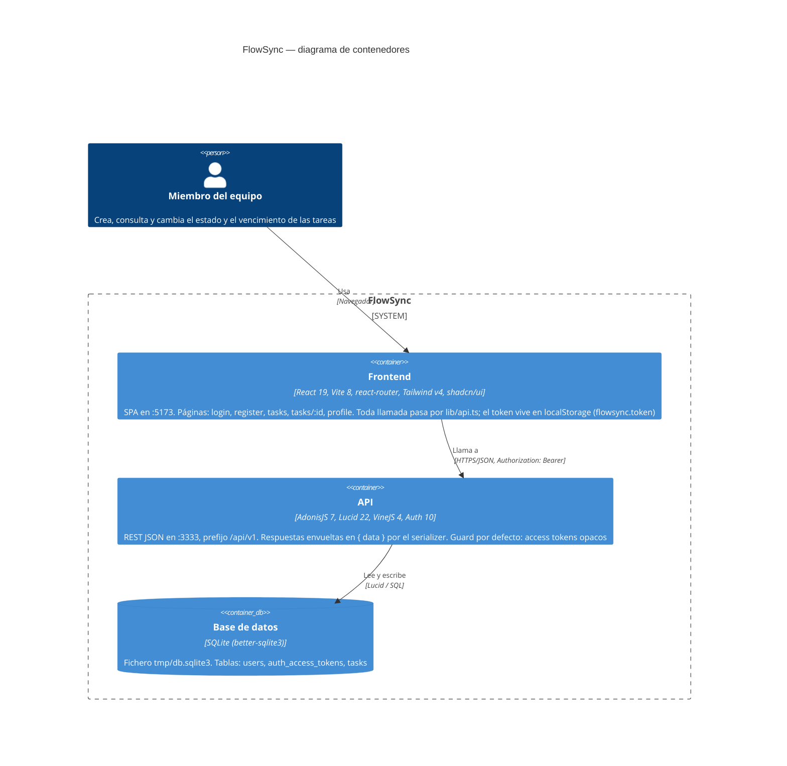
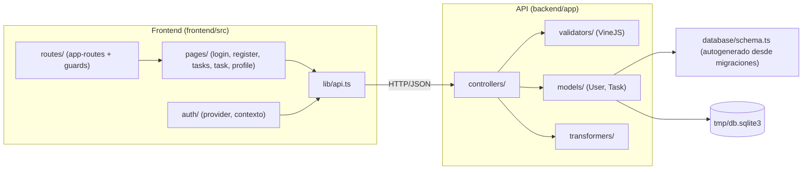

# Arquitectura de FlowSync

Diagrama de contenedores (nivel 2 de C4) de FlowSync tal y como está en el código: una SPA de React que habla por HTTP/JSON con una API de AdonisJS, y esa API que lee y escribe en un fichero SQLite. Dentro de cada contenedor se listan solo las piezas verificadas en `frontend/src` y `backend/`. No hay otros sistemas externos ni servicios: nada más se dibuja porque nada más se ha encontrado.

## Rutas de la API (`backend/start/routes.ts`)

| Método | Ruta | Controlador | Auth |
|---|---|---|---|
| POST | `/api/v1/auth/signup` | `NewAccountController.store` | no |
| POST | `/api/v1/auth/login` | `AccessTokensController.store` | no |
| GET | `/api/v1/account/profile` | `ProfileController.show` | sí |
| POST | `/api/v1/account/logout` | `AccessTokensController.destroy` | sí |
| GET | `/api/v1/tasks` | `TasksController.index` | sí |
| POST | `/api/v1/tasks` | `TasksController.store` | sí |
| GET | `/api/v1/tasks/:id` | `TasksController.show` | sí |
| PATCH | `/api/v1/tasks/:id/status` | `TaskStatusesController.update` | sí |
| PUT | `/api/v1/tasks/:id/due-date` | `TaskDueDatesController.update` | sí |

## Componentes por capa

Los transformers son `TaskTransformer` (lista, alta y cambio de estado), `TaskDetailTransformer` (tarea suelta y vencimiento, con `isOverdue`), `TaskAssigneeTransformer` (responsable: `id`, `fullName`, `initials`) y `UserTransformer` (cuenta).
